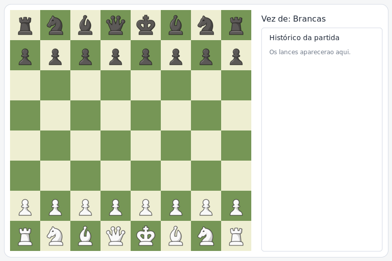

# ♟️ Xadrez

Um jogo de xadrez para duas pessoas, feito em Java com interface gráfica JavaFX. A partida acontece localmente no mesmo computador: os jogadores alternam os lances usando o mouse, e o aplicativo acompanha o turno, o histórico e situações de xeque.

> **Prévia da tela inicial** — ilustração do tabuleiro montada com as imagens de peças incluídas no projeto.



## 🎯 Objetivo

Praticar a implementação de um jogo de xadrez com interface gráfica e código organizado em camadas. O projeto separa a apresentação do tabuleiro, o controle dos cliques, o estado da partida e as regras de movimento das peças.

## ✨ O que o jogo oferece

| Recurso | Como funciona |
| --- | --- |
| Partida local para dois jogadores | Brancas e pretas jogam alternadamente no mesmo computador; as brancas começam. |
| Tabuleiro gráfico | Grade de 8 × 8 casas, com imagens para as peças claras e escuras. |
| Movimentos das peças | Implementa movimentos de peão, torre, cavalo, bispo, rainha e rei. |
| Validação de jogadas | Considera o formato do movimento, o caminho entre as casas e a cor da peça na casa de destino. |
| Xeque e xeque-mate | Verifica ataques ao rei e identifica xeque-mate. |
| Movimentos especiais | Inclui roque, captura *en passant* e promoção de peão para rainha, torre, bispo ou cavalo. |
| Turno e histórico | Exibe de quem é a vez e registra os lances na lista ao lado do tabuleiro. |

## 🎮 Como jogar

1. Inicie o aplicativo; a partida começa com as peças na posição inicial e a vez das brancas.
2. Clique em uma peça da sua cor para selecioná-la.
3. Clique na casa para onde deseja movê-la.
4. Se o lance for válido, a peça se move, o turno passa para o adversário e o lance aparece no histórico.
5. Se o rei ficar em xeque, o jogo registra a situação. Ao ocorrer xeque-mate, uma janela informa que a partida terminou.

Movimentos inválidos não avançam o turno. A interface não mostra previamente as casas possíveis: o jogador escolhe a casa de destino com um segundo clique.

## 🧰 Tecnologias

| Tecnologia | Uso |
| --- | --- |
| Java 25 | Linguagem e versão mínima configurada para compilação no projeto. |
| JavaFX 21.0.6 | Componentes da interface e carregamento da tela em FXML. |
| Maven | Gerenciamento de dependências, compilação e execução. |
| JUnit 5 | Dependência de testes configurada no projeto. |

> **Atenção:** o `pom.xml` configura o compilador para Java 25. Ter apenas Java 21 instalado não é suficiente para compilar este projeto.

## ▶️ Como executar

### Pré-requisitos

- JDK 25 instalado e configurado em `JAVA_HOME`/`PATH`.
- Uma sessão gráfica compatível com JavaFX.
- Conexão com a internet na primeira execução, para o Maven Wrapper baixar as dependências.

### Linux ou macOS

Na raiz do repositório:

```bash
./mvnw clean javafx:run
```

Se o Maven já estiver instalado, também é possível executar:

```bash
mvn clean javafx:run
```

### Windows

No Prompt de Comando ou PowerShell, na raiz do repositório:

```powershell
.\mvnw.cmd clean javafx:run
```

Para compilar sem abrir a janela:

```bash
./mvnw clean package
```

No Windows, substitua `./mvnw` por `.\mvnw.cmd`.

## 🧩 Organização do projeto

| Nome | Responsabilidade |
| --- | --- |
| `Jogo`, `Tabuleiro`, `Casa`, `Peca`, `Jogador`, `Posicao` | Representam o estado da partida, o tabuleiro, suas casas, peças, jogadores e posições. |
| `MovimentoPeao`, `MovimentoTorre`, `MovimentoCavalo`, `MovimentoBispo`, `MovimentoRainha`, `MovimentoRei` | Definem as regras de movimento de cada peça. |
| `JogoService`, `LogsService`, `DialogoService`, `VetorService`, `ValidadorService` | Reúnem a lógica da partida, o histórico, os diálogos e operações auxiliares. |
| `TabuleiroController` | Recebe os cliques e conecta a interface à lógica do jogo. |
| `TabuleiroView` | Cria e atualiza visualmente o tabuleiro e o histórico. |
| `tabuleiro.fxml` | Define a estrutura da janela do jogo. |
| `imagens das peças` | Ilustrações das peças brancas e pretas usadas no tabuleiro. |
| `tabuleiro-inicial.png` | Prévia ilustrativa do tabuleiro na posição inicial. |
| `pom.xml` | Configura as dependências, a compilação e a execução com Maven. |

### Fluxo de uma jogada

1. O controlador recebe os cliques nas casas e identifica a peça de origem e o destino.
2. O serviço do jogo verifica se o movimento é permitido e se deixa o próprio rei em segurança.
3. Se a jogada for válida, o estado do tabuleiro e o turno são atualizados.
4. A interface redesenha as peças e atualiza o indicador de turno e o histórico.

## 📌 Escopo

O jogo é uma aplicação local para duas pessoas. Não possui modo contra computador, partidas online ou salvamento e retomada de partidas.
